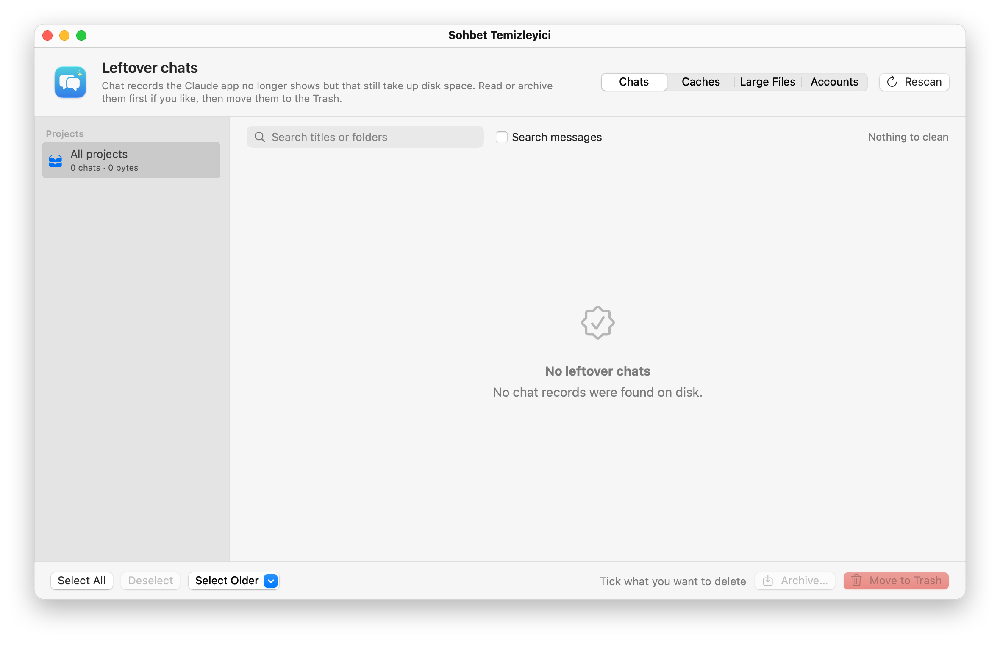

<div align="center">


# Sohbet Temizleyici

**Finds the chat records Claude leaves on your Mac after you delete a chat. Read or archive them first, then move the ones you pick to the Trash.**<br>
Also shows the large files Claude downloads and moves Claude Code sessions between your Claude accounts.

[](https://github.com/kralldepo/claude_arsiv/releases/latest)


[](LICENSE)

[**Download Sohbet-Temizleyici-1.1.dmg**](https://github.com/kralldepo/claude_arsiv/releases/latest/download/Sohbet-Temizleyici-1.1.dmg) · [All releases](https://github.com/kralldepo/claude_arsiv/releases) · [Türkçe](README.md)

</div>

<picture>
  <source media="(prefers-color-scheme: dark)" srcset="docs/screenshots/en-sohbetler-koyu.png">
  
</picture>

*Sohbet Temizleyici* is Turkish for "chat cleaner". The app opens in English when your Mac's language is not Turkish.

## Why?

Deleting a chat in the Claude desktop app only removes it from the list. Claude Code's transcripts (`~/.claude/projects/…/*.jsonl`) and their side files stay on disk and can add up to hundreds of megabytes. Claude also downloads gigabytes of virtual machine files for Cowork. Sohbet Temizleyici finds them, shows how much space they take and waits for you to decide what goes.

## Features

- **Leftover chats.** Lists chat records Claude no longer shows, with title, folder, date and size, grouped by project folder.
- **Read and archive.** Read a whole chat inside the app, or save chats as Markdown files (one `.md` per chat). Tool outputs and Claude's internal notes are left out.
- **Search messages.** Optional search inside the messages, ignoring case and accents.
- **You choose.** Nothing is ever pre-selected. *Select All* and *Select Older* (1 week, 1 month, 3 months) are only shortcuts.
- **Undo.** Everything goes to the Trash. The last deletion can be put back with one click (*Edit › Undo Last Deletion* or the banner button).
- **Caches and logs.** Claude's caches, logs, prompt history and files left by sessions whose chat is gone.
- **Large files.** The Cowork virtual machine and its compressed copies, old Claude Code versions and unused plugin files, each with what deleting it costs.
- **Moving between accounts.** Moves sessions in Claude's Code tab from one account to another.
- **Menu bar.** Optional: rescans every 30 minutes, notifies at most once a day when leftovers pile up, can start at login. It never deletes anything by itself.
- **Careful.** Never touches chats still listed or archived in Claude, sessions written in the last 30 minutes, or files of running programs. Cache cleaning, Cowork files and moving are locked while Claude is open.
- **Local.** No network access, no data sent anywhere, no Full Disk Access needed.

## Compatibility

| | |
|---|---|
| **Version** | 1.1 (build 2) |
| **Minimum macOS** | macOS 14.0 Sonoma |
| **Processor** | Universal: Apple Silicon (arm64) and Intel (x86_64). No Rosetta needed. |
| **Tested on** | macOS 27.2.1, Apple Silicon. The Intel code was run under Rosetta 2 on the same Mac, not on a real Intel Mac. |
| **Claude versions** | Tested with the file layout of Claude desktop 5.11492.5 and Claude Code 2.1.325 / 2.1.326. |
| **Size** | About 1.5 MB to download, about 4 MB installed |
| **Languages** | Turkish and English, following your Mac's language |

Works on every Mac that runs macOS 14 Sonoma or later. macOS 13 Ventura and earlier are not supported.

## Installing

1. Download `Sohbet-Temizleyici-1.1.dmg` from the [releases page](https://github.com/kralldepo/claude_arsiv/releases/latest).
2. Open the DMG and drag **Sohbet Temizleyici** to **Applications**. If 1.0 is installed, choose **Replace**; your settings and account names are kept.
3. The app is not notarized by Apple, so macOS warns on first launch. The full source is in this repository.
   - **macOS 15, 26 and 27:** Try to open the app and click **Done**. Then open **System Settings › Privacy & Security**, click **Open Anyway** next to *"Sohbet Temizleyici" was blocked* and confirm with your password.
   - **macOS 14:** Right-click the app in Finder, choose **Open**, then **Open** again.
   - **If macOS says the app is damaged**, run this in Terminal and open the app again:

     ```bash
     xattr -dr com.apple.quarantine "/Applications/Sohbet Temizleyici.app"
     ```

## What it touches

| Moves to the Trash if you select it | Never touches |
|---|---|
| `~/.claude/projects/*/<session>.jsonl` and the session's folder | Chats still listed or archived in Claude |
| The session's `file-history`, `session-env`, `tasks`, `todos` records | Sessions written in the last 30 minutes |
| `~/.claude/history.jsonl` | `memory` folders (Claude's notes) |
| Claude's caches, `~/Library/Logs/Claude` | Settings, plugins in use, plugin marketplaces |
| The four groups on the Large Files tab | The desktop app's own Claude Code copy and the version your terminal `claude` command runs |

Every path is checked against an allow list right before it is moved, and undo uses the same list. Reading and archiving never change Claude's files.

The full guide, including how moving sessions between accounts works, is in the [Turkish README](README.md).

## Building from source

Only the Command Line Tools are needed (`xcode-select --install`). Tested with Swift 6.4.2.

```bash
git clone https://github.com/kralldepo/claude_arsiv.git
cd claude_arsiv
./build.sh          # build/Sohbet Temizleyici.app (Apple Silicon + Intel)
./build.sh --dmg    # also build/Sohbet-Temizleyici-1.1.dmg
```

## License

[MIT](LICENSE).

---

<sub>Claude and Anthropic are trademarks of Anthropic PBC. This project is not made or endorsed by Anthropic.</sub>
