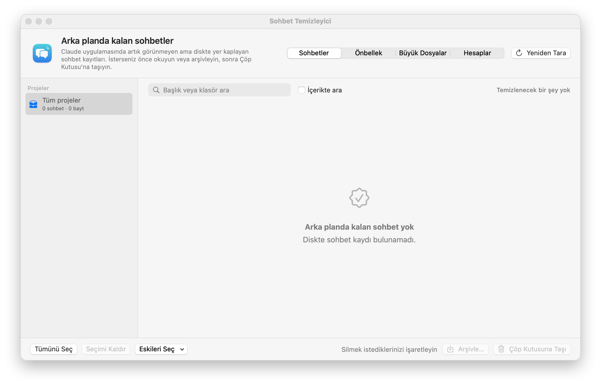
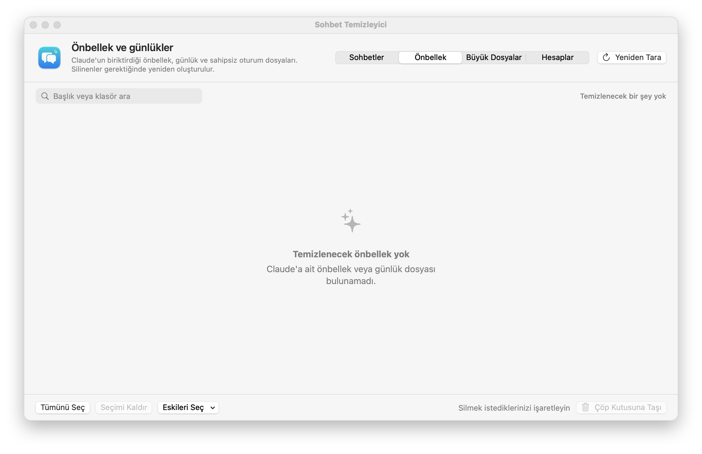
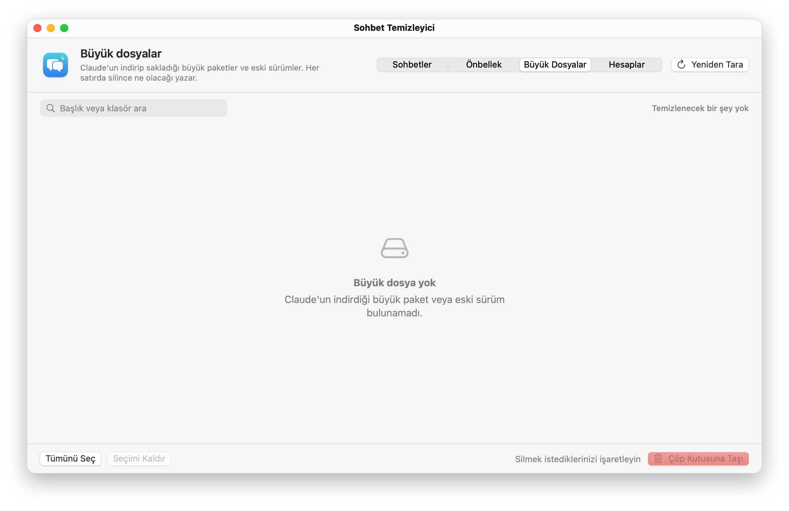
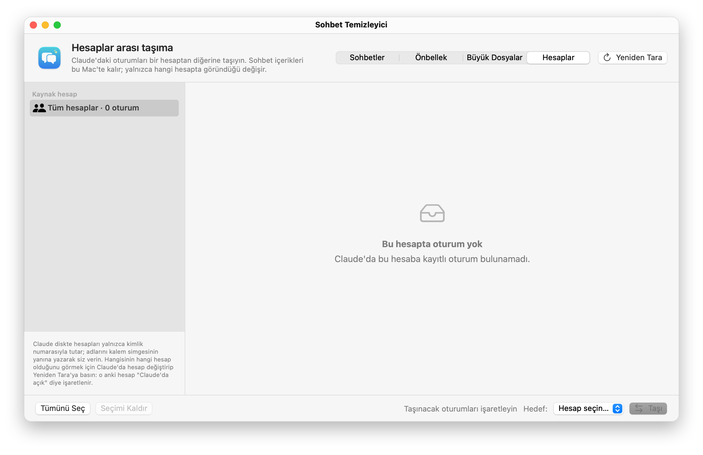
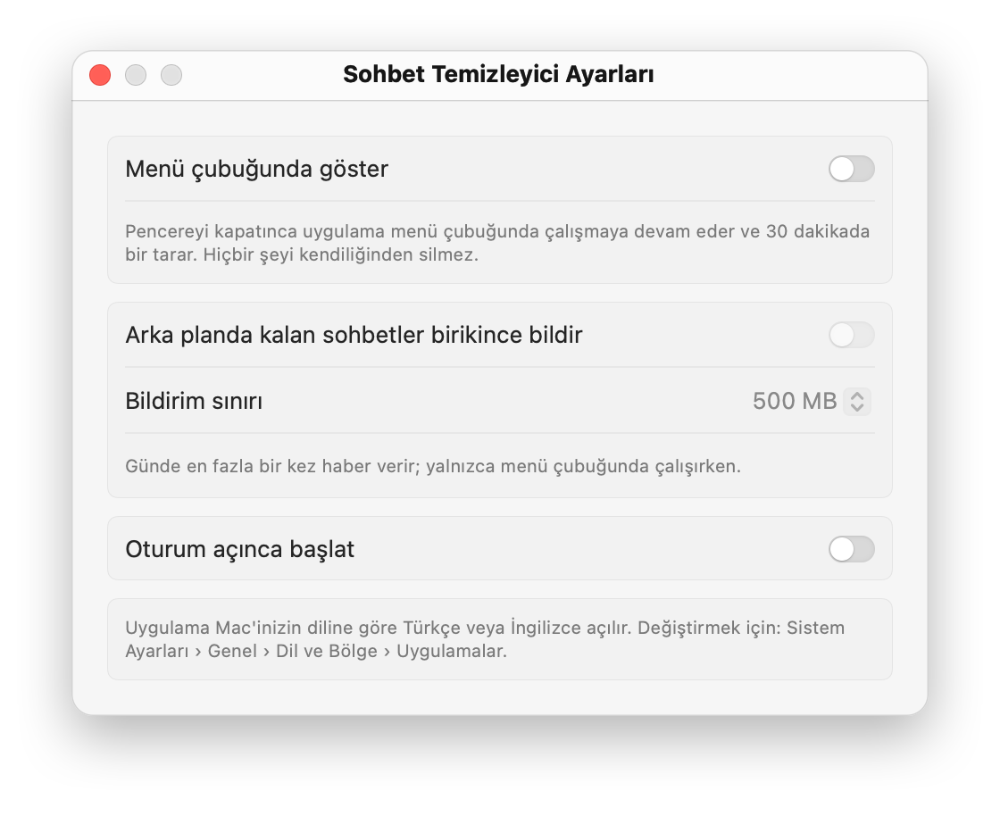

<div align="center">


# Sohbet Temizleyici

**Claude'da sildiğiniz ama Mac'inizde kalan sohbet kayıtlarını bulur. Önce okuyup arşivleyebilir, sonra seçtiklerinizi Çöp Kutusu'na taşıyabilirsiniz.**<br>
Claude'un indirip sakladığı büyük dosyaları gösterir, Claude Code oturumlarını Claude hesaplarınız arasında taşır.

[](https://github.com/kralldepo/claude_arsiv/releases/latest)


[](LICENSE)

[**Sohbet-Temizleyici-1.1.dmg indir**](https://github.com/kralldepo/claude_arsiv/releases/latest/download/Sohbet-Temizleyici-1.1.dmg) · [Tüm sürümler](https://github.com/kralldepo/claude_arsiv/releases) · [English](README.en.md)

</div>

<picture>
  <source media="(prefers-color-scheme: dark)" srcset="docs/screenshots/sohbetler-koyu.png">
  
</picture>

## 1.1'de yeni

- **Sohbeti okuyun.** Silmeden önce sohbetin tamamını uygulamanın içinde okuyun.
- **Markdown olarak arşivleyin.** Seçtiğiniz sohbetleri bir klasöre, her biri ayrı bir `.md` dosyası olarak kaydedin.
- **İçerikte arayın.** Yalnızca başlıkta değil, mesajların içinde de arayın.
- **Geri alın.** Son silme işlemini tek tıkla geri getirin.
- **Projelere göre gruplayın.** Sohbetler soldaki listede proje klasörüne göre ayrılır.
- **Büyük Dosyalar.** Cowork sanal makinesi, eski Claude Code sürümleri ve kullanılmayan eklenti dosyaları; her satırda silince ne olacağı yazar.
- **Menü çubuğu ve bildirim.** İsterseniz arka planda çalışır, sohbetler birikince günde en fazla bir kez haber verir. Hiçbir şeyi kendiliğinden silmez.
- **İngilizce arayüz.** Uygulama Mac'inizin diline göre Türkçe veya İngilizce açılır.
- 1.0'daki tüm özellikler aynen duruyor. Ayrıntılar [sürüm notlarında](https://github.com/kralldepo/claude_arsiv/releases/tag/v1.1).

## Neden?

Claude masaüstü uygulamasında bir sohbeti silmek onu yalnızca listeden kaldırır. Claude Code'un sohbet dökümleri (`~/.claude/projects/…/*.jsonl`) ve yan dosyaları diskte kalır; zamanla yüzlerce megabayt birikebilir. Claude ayrıca Cowork için gigabaytlarca sanal makine dosyası indirir. Sohbet Temizleyici bunları bulur, ne kadar yer kapladıklarını gösterir ve hangilerinin silineceğine sizin karar vermenizi bekler.

## Özellikler

- **Arka planda kalan sohbetler.** Claude'da artık görünmeyen sohbet kayıtlarını başlığı, klasörü, tarihi ve boyutuyla listeler, proje klasörüne göre gruplar.
- **Okuma ve arşiv.** Bir sohbeti silmeden önce okuyabilir veya Markdown dosyası olarak saklayabilirsiniz. Araç çıktıları ve Claude'un iç notları gösterilmez, arşive de girmez.
- **İçerikte arama.** Büyük/küçük harf ve Türkçe karakter farkı gözetmez: `gorsel` yazınca `Görsel` de bulunur.
- **Seçim sizde.** Hiçbir şey kendiliğinden seçili gelmez. *Tümünü Seç* ve *Eskileri Seç* (1 hafta, 1 ay, 3 ay) yalnızca kısayoldur.
- **Geri alınabilir.** Silinenler Çöp Kutusu'na gider. Son silme işlemi uygulamadan tek tıkla geri getirilir; daha eskiler Finder'dan geri alınabilir.
- **Önbellek ve günlükler.** Claude'un önbelleklerini, günlüklerini, istem geçmişini ve sahibi kalmamış oturum dosyalarını gösterir.
- **Büyük dosyalar.** Claude'un tekrar indirebileceği büyük paketleri, her birini silmenin bedeliyle birlikte listeler.
- **Hesaplar arası taşıma.** Claude'un Code sekmesindeki oturumları bir hesaptan diğerine taşır.
- **Menü çubuğu.** İsteğe bağlı: 30 dakikada bir tarar, birikince bildirim gönderir, oturum açınca başlayabilir.
- **Temkinli.** Claude'da hâlâ açık veya arşivde duran sohbetlere, son 30 dakikada yazılmış oturumlara ve çalışan programlara dokunmaz. Claude açıkken önbellek temizliğini, Cowork dosyalarını ve taşımayı kilitler.
- **Yerel.** İnternete bağlanmaz, hiçbir veri göndermez, Tam Disk Erişimi istemez.

## Ekran görüntüleri

<table>
  <tr>
    <td width="50%">
      <picture>
        <source media="(prefers-color-scheme: dark)" srcset="docs/screenshots/onbellek-koyu.png">
        
      </picture>
      <p align="center"><b>Önbellek</b></p>
    </td>
    <td width="50%">
      <picture>
        <source media="(prefers-color-scheme: dark)" srcset="docs/screenshots/buyuk-dosyalar-koyu.png">
        
      </picture>
      <p align="center"><b>Büyük Dosyalar</b></p>
    </td>
  </tr>
  <tr>
    <td width="50%">
      <picture>
        <source media="(prefers-color-scheme: dark)" srcset="docs/screenshots/hesaplar-koyu.png">
        
      </picture>
      <p align="center"><b>Hesaplar</b></p>
    </td>
    <td width="50%">
      <picture>
        <source media="(prefers-color-scheme: dark)" srcset="docs/screenshots/ayarlar-koyu.png">
        
      </picture>
      <p align="center"><b>Ayarlar</b></p>
    </td>
  </tr>
</table>

<p align="center">
  <picture>
    <source media="(prefers-color-scheme: dark)" srcset="docs/screenshots/hakkinda-koyu.png">
    
  </picture>
</p>

Görüntüler boş bir test klasörüyle alındı; kendi Mac'inizde sohbetleriniz, dosyalarınız ve hesaplarınız listelenir.

## Uyumluluk

| | |
|---|---|
| **Sürüm** | 1.1 (yapı 2) |
| **En düşük macOS** | macOS 14.0 Sonoma |
| **İşlemci** | Universal: Apple Silicon (arm64) ve Intel (x86_64) tek dosyada. Rosetta gerekmez. |
| **Test edildiği sistem** | macOS 27.2.1, Apple Silicon. Intel kodu aynı Mac'te Rosetta 2 ile çalıştırılarak denendi; gerçek bir Intel Mac'te denenmedi. |
| **Claude sürümü** | Claude masaüstü 5.11492.5 ve Claude Code 2.1.325 / 2.1.326'nın dosya düzeniyle test edildi. |
| **Boyut** | DMG yaklaşık 1,5 MB, kurulu uygulama yaklaşık 4 MB |
| **İzinler** | Tam Disk Erişimi gerekmez. Bildirimleri açarsanız macOS bildirim izni sorar. |
| **İnternet** | Gerekmez. Uygulama hiçbir bağlantı kurmaz. |
| **Dil** | Türkçe ve İngilizce, Mac'in diline göre |

| macOS | Apple Silicon | Intel | İlk açılışta |
|---|:---:|:---:|---|
| macOS 27 | ✅ test edildi | — ¹ | Sistem Ayarları › Gizlilik ve Güvenlik › **Yine de Aç** |
| macOS 26 Tahoe | ✅ | ✅ | Sistem Ayarları › Gizlilik ve Güvenlik › **Yine de Aç** |
| macOS 15 Sequoia | ✅ | ✅ | Sistem Ayarları › Gizlilik ve Güvenlik › **Yine de Aç** |
| macOS 14 Sonoma | ✅ | ✅ | Finder'da uygulamaya sağ tıklayıp **Aç** |
| macOS 13 Ventura ve öncesi | ❌ | ❌ | Uygulama açılmaz |

¹ macOS 27 yalnızca Apple Silicon Mac'lerde çalışır. Intel Mac'lerin alabildiği son sürüm macOS 26 Tahoe'dur.

**Hangi Mac'ler?** macOS 14 Sonoma veya üstünü çalıştırabilen her Mac: tüm Apple Silicon Mac'ler (M1 ve sonrası) ve Intel tarafında 2018 ve sonrası MacBook Air, MacBook Pro ve Mac mini, 2019 ve sonrası iMac, iMac Pro (2017) ile Mac Pro (2019).

**Claude güncellemeleri.** Uygulama, Claude'un diskteki dosya düzenini okur. Claude bu düzeni bir güncellemede değiştirirse liste eksik kalabilir veya hesaplar arası taşıma yanlış çalışabilir. Büyük bir Claude güncellemesinden sonra taşımayı önce tek bir oturumla deneyin.

## Kurulum

1. [Sürümler](https://github.com/kralldepo/claude_arsiv/releases/latest) sayfasından `Sohbet-Temizleyici-1.1.dmg` dosyasını indirin.
2. DMG'yi açın ve **Sohbet Temizleyici**'yi **Applications** (Uygulamalar) klasörüne sürükleyin. 1.0 kuruluysa **Değiştir**'i seçin; ayarlarınız ve hesap adlarınız korunur.
3. Uygulamayı ilk kez açarken macOS uyarı verir, çünkü uygulama ücretli bir Apple geliştirici hesabıyla imzalanıp Apple'a onaylatılmadı (notarization). Kaynak kodun tamamı bu depoda; isterseniz kendiniz derleyebilirsiniz.
   - **macOS 15, 26 ve 27:** Uygulamayı açmayı deneyin, çıkan uyarıda **Bitti**'ye basın. Sonra **Sistem Ayarları › Gizlilik ve Güvenlik** bölümünü açın, en alttaki *"Sohbet Temizleyici" engellendi* satırında **Yine de Aç**'a basın ve parolanızla onaylayın.
   - **macOS 14:** Finder'da uygulamaya sağ tıklayın (veya Control tuşuyla tıklayın), **Aç**'ı seçin ve açılan pencerede yine **Aç**'a basın.
   - **"Hasarlı" uyarısı görürseniz** Terminal'de şunu çalıştırın, sonra uygulamayı normal açın:

     ```bash
     xattr -dr com.apple.quarantine "/Applications/Sohbet Temizleyici.app"
     ```

Bu onay yalnızca ilk açılışta gerekir.

## Kullanım

### Sohbetler

1. Soldan bir proje seçin veya **Tüm projeler**'de kalın.
2. Bir sohbeti okumak için satırdaki konuşma balonuna basın ya da sağ tıklayıp **Sohbeti Oku**'yu seçin.
3. Saklamak istediklerinizi işaretleyip **Arşivle…**'ye basın ve bir klasör seçin. Her sohbet `2026-11-18 Başlık.md` gibi ayrı bir dosya olur.
4. Silmek istediklerinizi işaretleyin, **Çöp Kutusuna Taşı**'ya basıp onaylayın.

*İçerikte ara* kutusunu işaretlerseniz arama, başlık ve klasörün yanında mesajların içine de bakar. Claude'da hâlâ kayıtlı sohbetler varsayılan olarak gizlidir. *Claude'da kayıtlı … sohbeti de göster* kutusuyla görebilir, okuyabilir ve arşivleyebilirsiniz ama silemezsiniz; onları önce Claude uygulamasından silin.

### Geri alma

Silmeden sonra çıkan şeritteki **Geri Al**'a veya **Düzen › Son Silmeyi Geri Al**'a basın: son silinenler eski yerlerine döner. Var olan bir dosyanın üzerine yazılmaz. Bu kısayol yalnızca son işlem için ve uygulama açıkken geçerlidir; daha eskileri Finder'da Çöp Kutusu'ndan geri alabilirsiniz.

### Önbellek

Claude'un önbelleklerini, günlüklerini, `~/.claude/history.jsonl` istem geçmişini ve sohbeti silinmiş oturumlardan kalan klasörleri listeler. Önbellek ve günlükler yalnızca Claude kapalıyken silinebilir; Claude'dan çıkınca (⌘Q) liste kendiliğinden güncellenir. Silinen önbellekleri Claude gerektiğinde yeniden oluşturur.

### Büyük Dosyalar

| Satır | Neler | Silince ne olur |
|---|---|---|
| Cowork sanal makinesi | `~/Library/Application Support/Claude/vm_bundles` ve `claude-code-vm` | Cowork bir sonraki kullanımda yaklaşık 1,3 GB indirir ve 15 GB boş alan ister. Cowork'ün oturum diski de silinir. Yalnızca Claude kapalıyken. |
| Cowork sıkıştırılmış kopyaları | `claudevm.bundle` içindeki `.zst` dosyaları | Sanal makine çalışmaya devam eder; bir sonraki Cowork güncellemesi veya yeniden kurulumu tam indirme gerektirir. Yalnızca Claude kapalıyken. |
| Eski Claude Code sürümleri | `~/.local/share/claude/versions` | Terminaldeki `claude` komutunun yedek sürümleridir. Claude Code bunları güncellemelerde zaten kendisi siler; silerseniz geri dönülecek yedek sürüm kalmaz. |
| Kullanılmayan eklenti dosyaları | `~/.claude/plugins/cache` içinde kullanılmıyor diye işaretlenmiş sürümler ve `~/.claude/plugins/.trash` | Claude Code bunları birkaç gün içinde zaten kendisi siler. |

Bu sekme şunları hiç listelemez: Claude masaüstünün çalıştırdığı Claude Code kopyası (`claude-code`), terminaldeki `claude` komutunun kullandığı sürüm, çalışan veya kilitli sürümler, kullanılan eklenti sürümleri ve eklenti pazarları.

### Hesaplar

Claude her Code oturumu için `~/Library/Application Support/Claude/claude-code-sessions/<hesap>/<kuruluş>/local_<id>.json` kaydını tutar. Kayıt hangi hesabın klasöründeyse oturum o hesapta görünür. Sohbetin içeriği `~/.claude/projects` altında tüm hesaplar için ortaktır ve yerinden oynamaz.

1. Claude'dan çıkın (⌘Q). Claude açıkken kayıtları kendisi yeniden yazdığı için taşıma kilitlidir.
2. Soldan kaynak hesabı seçin, taşınacak oturumları işaretleyin.
3. Alttan hedef hesabı seçip **Taşı**'ya basın.
4. Claude'u açıp hedef hesaba geçin; oturumlar orada görünür.

- Kayıt hedef hesaba yazılır, eski hesaba ait hata işaretleri temizlenir, arşiv bilgisi korunur. Eski kayıt Çöp Kutusu'na gider.
- Geri almak için oturumu aynı ekrandan eski hesaba geri taşıyın.
- Çalışma ağacında (worktree) açılmış oturumlar taşınmaz: Claude sahipsiz sandığı çalışma ağacı klasörünü temizleyebilir ve içindeki iş kaybolabilir.
- Claude hesapları diskte yalnızca kimlik numarasıyla tutar. Hesaplara adı kalem simgesinin yanına yazarak siz verirsiniz; o an Claude'da açık olan hesap işaretlenir.

### Menü çubuğu, bildirim ve dil

**Sohbet Temizleyici › Ayarlar…** (⌘,) penceresinde:

- **Menü çubuğunda göster:** Pencereyi kapatınca uygulama menü çubuğunda kalır ve 30 dakikada bir tarar. Menüden toplamları görür, pencereyi açar veya yeniden taratırsınız.
- **Arka planda kalan sohbetler birikince bildir:** Toplam, seçtiğiniz sınırı (250 MB ile 5 GB arası) aşınca günde en fazla bir bildirim gönderir. Yalnızca menü çubuğunda çalışırken.
- **Oturum açınca başlat:** Mac açılınca uygulamayı başlatır.

Uygulama hiçbir şeyi kendiliğinden silmez. Arayüz Mac'inizin diline göre Türkçe veya İngilizce açılır; yalnızca bu uygulamanın dilini değiştirmek için **Sistem Ayarları › Genel › Dil ve Bölge › Uygulamalar** bölümünü kullanın.

## Neye dokunur, neye dokunmaz

| Seçerseniz Çöp Kutusu'na taşır | Asla dokunmaz |
|---|---|
| `~/.claude/projects/*/<oturum>.jsonl` ve aynı oturumun klasörü | Claude'da hâlâ açık veya arşivde duran sohbetler |
| O oturumun `file-history`, `session-env`, `tasks`, `todos` kayıtları | Son 30 dakikada yazılmış oturumlar |
| `~/.claude/history.jsonl` | `memory` klasörleri (Claude'un notları) |
| Claude önbellekleri, `~/Library/Logs/Claude` | Ayarlar, kullanılan eklentiler, eklenti pazarları |
| Büyük Dosyalar sekmesindeki dört grup | Claude masaüstünün Code kopyası ve terminalde kullanılan Claude Code sürümü |
| | Çalışan programların dosyaları |

Bir sohbetin "arka planda kalmış" sayılması için `~/Library/Application Support/Claude/claude-code-sessions` altındaki hiçbir oturum kaydında kimliğinin geçmemesi gerekir. Her silme öncesi yol bir izin listesiyle yeniden denetlenir; geri alma da aynı listeyi kullanır. Arşivleme ve okuma salt okunurdur, kayıtları değiştirmez.

## Kaynaktan derleme

Xcode gerekmez, Command Line Tools yeterli (`xcode-select --install`). Swift 6.4.2 ile denendi.

```bash
git clone https://github.com/kralldepo/claude_arsiv.git
cd claude_arsiv
./build.sh          # build/Sohbet Temizleyici.app (Apple Silicon + Intel)
./build.sh --dmg    # ayrıca build/Sohbet-Temizleyici-1.1.dmg
```

Command Line Tools'ta SwiftUI'nin makro eklentisi bulunmadığı için kodda `@State` yerine `Store` içindeki `@Published` alanlar kullanılır. Metinlerin anahtarı Türkçe metnin kendisidir; İngilizce çeviriler `Resources/en.lproj` içindedir.

<details>
<summary>Proje yapısı</summary>

| Dosya | Görevi |
|---|---|
| `Sources/SohbetTemizleyici/App.swift` | Uygulama, menüler, Hakkında penceresi, ekran görüntüsü modu |
| `Sources/SohbetTemizleyici/ContentView.swift` | Ana pencere |
| `Sources/SohbetTemizleyici/ConversationView.swift` | Sohbet okuma penceresi |
| `Sources/SohbetTemizleyici/MenuBar.swift` | Menü çubuğu menüsü ve Ayarlar |
| `Sources/SohbetTemizleyici/Store.swift` | Durum, seçim ve işlemler |
| `Sources/SohbetTemizleyici/Scanner.swift` | Salt okunur tarama |
| `Sources/SohbetTemizleyici/LargeFiles.swift` | Büyük dosyalar ve çalışan programların denetimi |
| `Sources/SohbetTemizleyici/Transcript.swift` | Döküm okuma, Markdown arşivi, içerik araması |
| `Sources/SohbetTemizleyici/Trasher.swift` | Çöp Kutusu'na taşıma, geri alma ve yol izin listesi |
| `Sources/SohbetTemizleyici/Accounts.swift` | Hesaplar arası taşıma |
| `Sources/SohbetTemizleyici/CLI.swift` | Komut satırı test modları |
| `Sources/SohbetTemizleyici/Model.swift` | Veri tipleri ve biçimlendirme |
| `Resources/en.lproj`, `Resources/tr.lproj` | İngilizce çeviriler; Türkçe kaynak dildir |
| `Tools/make-icon.swift` | Uygulama simgesini çizer |
| `build.sh` | Universal derleme ve DMG |

</details>

<details>
<summary>Test modları</summary>

```bash
"build/Sohbet Temizleyici.app/Contents/MacOS/SohbetTemizleyici" --report --verbose
```

- `--report`: Salt okunur özet basar, hiçbir şeyi değiştirmez.
- `--snapshot dosya.png [--light | --dark] [--caches | --large | --accounts] [--select] [--preview | --about | --settings]`: Pencerenin görüntüsünü kaydedip kapanır.
- `-AppleLanguages "(en)"`: Uygulamayı İngilizce açar.

Aşağıdakiler yalnızca `SOHBET_HOME=/sahte/ev` ile çalışır, gerçek ev klasörünüze dokunmaz:

- `--test-trash`: Kilitli olmayan her şeyi Çöp Kutusu'na taşır.
- `--test-undo`: Her şeyi Çöp Kutusu'na taşıyıp geri getirir, eksik kalan olup olmadığını denetler.
- `--test-archive <klasör>`: Bütün sohbetleri Markdown olarak yazar.
- `--test-search <metin>`: İçerik aramasının bulduğu sohbetleri basar.
- `--test-allowed <yol>`: Yolun izin listesinde olup olmadığını basar.
- `--test-move local_<id> <hesap>/<kuruluş>`: Bir oturumu başka hesaba taşır.
- `SOHBET_CLAUDE_RUNNING=0` veya `1`: Claude'un açık olup olmadığını taklit eder.

</details>

## Lisans

[MIT](LICENSE). Kodu kullanabilir, değiştirebilir ve dağıtabilirsiniz; yalnızca telif ve lisans notunu korumanız gerekir. Yazılım "olduğu gibi" sunulur ve hiçbir garanti verilmez.

---

<sub>Claude ve Anthropic, Anthropic PBC'nin ticari markalarıdır. Bu proje Anthropic tarafından geliştirilmemiş veya onaylanmamıştır.</sub>
