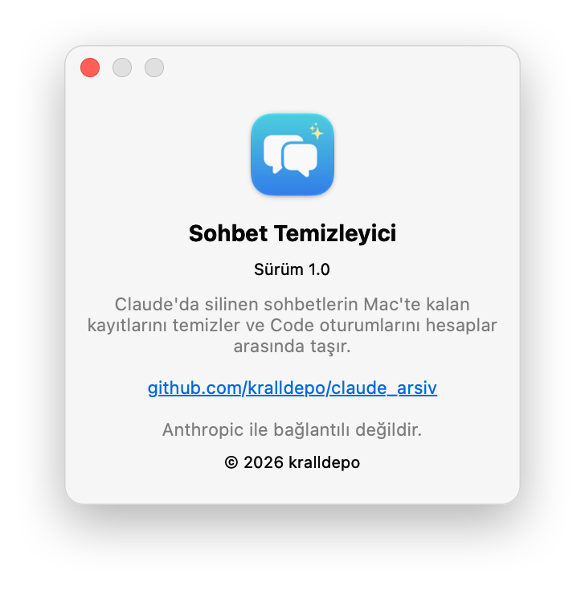

<div align="center">


# Sohbet Temizleyici

**Claude'da sildiğiniz ama Mac'inizde kalan sohbet kayıtlarını bulur, seçtiklerinizi Çöp Kutusu'na taşır.**<br>
Claude Code oturumlarını Claude hesaplarınız arasında taşır.

[](https://github.com/kralldepo/claude_arsiv/releases/latest)


[**Sohbet-Temizleyici-1.0.dmg indir**](https://github.com/kralldepo/claude_arsiv/releases/latest/download/Sohbet-Temizleyici-1.0.dmg) · [Tüm sürümler](https://github.com/kralldepo/claude_arsiv/releases)

</div>

<picture>
  <source media="(prefers-color-scheme: dark)" srcset="docs/screenshots/sohbetler-koyu.png">
  
</picture>

## Neden?

Claude masaüstü uygulamasında bir sohbeti silmek onu yalnızca listeden kaldırır. Claude Code'un sohbet dökümleri (`~/.claude/projects/…/*.jsonl`) ve yan dosyaları diskte kalır; zamanla yüzlerce megabayt birikebilir. Sohbet Temizleyici bunları bulur, ne kadar yer kapladıklarını gösterir ve hangilerinin silineceğine sizin karar vermenizi bekler.

## Özellikler

- **Arka planda kalan sohbetler.** Claude'da artık görünmeyen sohbet kayıtlarını başlığı, klasörü, tarihi ve boyutuyla listeler. Başlığın üzerine gelince sohbetin ilk mesajı görünür.
- **Seçim sizde.** Hiçbir şey kendiliğinden seçili gelmez. *Tümünü Seç* ve *Eskileri Seç* (1 hafta, 1 ay, 3 ay) yalnızca kısayoldur.
- **Geri alınabilir.** Silinenler Çöp Kutusu'na gider; Çöp Kutusu boşaltılana kadar Finder'dan geri alınabilir.
- **Önbellek ve günlükler.** Claude'un önbelleklerini, günlüklerini, istem geçmişini ve sahibi kalmamış oturum dosyalarını gösterir.
- **Hesaplar arası taşıma.** Claude'un Code sekmesindeki oturumları bir hesaptan diğerine taşır.
- **Temkinli.** Claude'da hâlâ açık veya arşivde duran sohbetlere ve son 30 dakikada yazılmış oturumlara dokunmaz. Claude açıkken önbellek temizliğini ve taşımayı kilitler.
- **Yerel.** İnternete bağlanmaz, hiçbir veri göndermez, özel izin istemez.

## Ekran görüntüleri

<table>
  <tr>
    <td width="50%">
      <picture>
        <source media="(prefers-color-scheme: dark)" srcset="docs/screenshots/onbellek-koyu.png">
        
      </picture>
      <p align="center"><b>Önbellek ve Günlükler</b></p>
    </td>
    <td width="50%">
      <picture>
        <source media="(prefers-color-scheme: dark)" srcset="docs/screenshots/hesaplar-koyu.png">
        
      </picture>
      <p align="center"><b>Hesaplar Arası</b></p>
    </td>
  </tr>
</table>

<p align="center">
  <picture>
    <source media="(prefers-color-scheme: dark)" srcset="docs/screenshots/hakkinda-koyu.png">
    
  </picture>
</p>

Görüntüler boş bir test klasörüyle alındı; kendi Mac'inizde sohbetleriniz ve hesaplarınız listelenir.

## Uyumluluk

| | |
|---|---|
| **Sürüm** | 1.0 (yapı 1) |
| **En düşük macOS** | macOS 14.0 Sonoma |
| **İşlemci** | Universal: Apple Silicon (arm64) ve Intel (x86_64) tek dosyada. Rosetta gerekmez. |
| **Test edildiği sistem** | macOS 27.2.1, Apple Silicon. Intel kodu aynı Mac'te Rosetta 2 ile çalıştırılarak denendi; gerçek bir Intel Mac'te denenmedi. |
| **Claude sürümü** | Claude masaüstü 5.11492.5 ve Claude Code 2.1.325'in dosya düzeniyle test edildi. |
| **Boyut** | DMG yaklaşık 1 MB, kurulu uygulama yaklaşık 2,5 MB |
| **İzinler** | Tam Disk Erişimi veya başka bir izin gerekmez. |
| **İnternet** | Gerekmez. Uygulama hiçbir bağlantı kurmaz. |
| **Dil** | Türkçe |

| macOS | Apple Silicon | Intel | İlk açılışta |
|---|:---:|:---:|---|
| macOS 27 | ✅ test edildi | — ¹ | Sistem Ayarları › Gizlilik ve Güvenlik › **Yine de Aç** |
| macOS 26 Tahoe | ✅ | ✅ | Sistem Ayarları › Gizlilik ve Güvenlik › **Yine de Aç** |
| macOS 15 Sequoia | ✅ | ✅ | Sistem Ayarları › Gizlilik ve Güvenlik › **Yine de Aç** |
| macOS 14 Sonoma | ✅ | ✅ | Finder'da uygulamaya sağ tıklayıp **Aç** |
| macOS 13 Ventura ve öncesi | ❌ | ❌ | Uygulama açılmaz |

¹ macOS 27 yalnızca Apple Silicon Mac'lerde çalışır. Intel Mac'lerin alabildiği son sürüm macOS 26 Tahoe'dur.

**Hangi Mac'ler?** macOS 14 Sonoma veya üstünü çalıştırabilen her Mac: tüm Apple Silicon Mac'ler (M1 ve sonrası) ve Intel tarafında 2018 ve sonrası MacBook Air, MacBook Pro ve Mac mini, 2019 ve sonrası iMac, iMac Pro (2017) ile Mac Pro (2019).

**Claude güncellemeleri.** Uygulama, Claude'un diskteki dosya düzenini okur. Claude bu düzeni bir güncellemede değiştirirse liste eksik kalabilir veya hesaplar arası taşıma yanlış çalışabilir. Büyük bir Claude güncellemesinden sonra taşımayı önce tek bir oturumla deneyin.

## Kurulum

1. [Sürümler](https://github.com/kralldepo/claude_arsiv/releases/latest) sayfasından `Sohbet-Temizleyici-1.0.dmg` dosyasını indirin.
2. DMG'yi açın ve **Sohbet Temizleyici**'yi **Applications** (Uygulamalar) klasörüne sürükleyin.
3. Uygulamayı ilk kez açarken macOS uyarı verir, çünkü uygulama ücretli bir Apple geliştirici hesabıyla imzalanıp Apple'a onaylatılmadı (notarization). Kaynak kodun tamamı bu depoda; isterseniz kendiniz derleyebilirsiniz.
   - **macOS 15, 26 ve 27:** Uygulamayı açmayı deneyin, çıkan uyarıda **Bitti**'ye basın. Sonra **Sistem Ayarları › Gizlilik ve Güvenlik** bölümünü açın, en alttaki *"Sohbet Temizleyici" engellendi* satırında **Yine de Aç**'a basın ve parolanızla onaylayın.
   - **macOS 14:** Finder'da uygulamaya sağ tıklayın (veya Control tuşuyla tıklayın), **Aç**'ı seçin ve açılan pencerede yine **Aç**'a basın.
   - **"Hasarlı" uyarısı görürseniz** Terminal'de şunu çalıştırın, sonra uygulamayı normal açın:

     ```bash
     xattr -dr com.apple.quarantine "/Applications/Sohbet Temizleyici.app"
     ```

Bu onay yalnızca ilk açılışta gerekir.

## Kullanım

### Sohbetler

1. Silmek istediğiniz sohbetleri işaretleyin. Başlığın üzerine gelince ilk mesaj, sağ tıklayınca *Finder'da Göster* çıkar.
2. **Çöp Kutusuna Taşı**'ya basıp onaylayın.

Claude'da hâlâ kayıtlı sohbetler varsayılan olarak gizlidir. *Claude'da kayıtlı … sohbeti de göster* kutusuyla görebilirsiniz ama silemezsiniz; onları önce Claude uygulamasından silin.

### Önbellek ve Günlükler

Claude'un önbelleklerini, günlüklerini, `~/.claude/history.jsonl` istem geçmişini ve sohbeti silinmiş oturumlardan kalan klasörleri listeler. Önbellek ve günlükler yalnızca Claude kapalıyken silinebilir; Claude'dan çıkınca (⌘Q) liste kendiliğinden güncellenir. Silinen önbellekleri Claude gerektiğinde yeniden oluşturur.

### Hesaplar Arası

Claude her Code oturumu için `~/Library/Application Support/Claude/claude-code-sessions/<hesap>/<kuruluş>/local_<id>.json` kaydını tutar. Kayıt hangi hesabın klasöründeyse oturum o hesapta görünür. Sohbetin içeriği `~/.claude/projects` altında tüm hesaplar için ortaktır ve yerinden oynamaz.

1. Claude'dan çıkın (⌘Q). Claude açıkken kayıtları kendisi yeniden yazdığı için taşıma kilitlidir.
2. Soldan kaynak hesabı seçin, taşınacak oturumları işaretleyin.
3. Alttan hedef hesabı seçip **Taşı**'ya basın.
4. Claude'u açıp hedef hesaba geçin; oturumlar orada görünür.

- Kayıt hedef hesaba yazılır, eski hesaba ait hata işaretleri temizlenir, arşiv bilgisi korunur. Eski kayıt Çöp Kutusu'na gider.
- Geri almak için oturumu aynı ekrandan eski hesaba geri taşıyın.
- Çalışma ağacında (worktree) açılmış oturumlar taşınmaz: Claude sahipsiz sandığı çalışma ağacı klasörünü temizleyebilir ve içindeki iş kaybolabilir.
- Claude hesapları diskte yalnızca kimlik numarasıyla tutar. Hesaplara adı kalem simgesinin yanına yazarak siz verirsiniz; o an Claude'da açık olan hesap işaretlenir.

## Neye dokunur, neye dokunmaz

| Seçerseniz Çöp Kutusu'na taşır | Asla dokunmaz |
|---|---|
| `~/.claude/projects/*/<oturum>.jsonl` ve aynı oturumun klasörü | Claude'da hâlâ açık veya arşivde duran sohbetler |
| O oturumun `file-history`, `session-env`, `tasks`, `todos` kayıtları | Son 30 dakikada yazılmış oturumlar |
| `~/.claude/history.jsonl` | `memory` klasörleri (Claude'un notları) |
| Claude önbellekleri, `~/Library/Logs/Claude` | Ayarlar, eklentiler, `vm_bundles` |

Bir sohbetin "arka planda kalmış" sayılması için `~/Library/Application Support/Claude/claude-code-sessions` altındaki hiçbir oturum kaydında kimliğinin geçmemesi gerekir. Her silme öncesi yol bir izin listesiyle yeniden denetlenir.

## Kaynaktan derleme

Xcode gerekmez, Command Line Tools yeterli (`xcode-select --install`). Swift 6.4.2 ile denendi.

```bash
git clone https://github.com/kralldepo/claude_arsiv.git
cd claude_arsiv
./build.sh          # build/Sohbet Temizleyici.app (Apple Silicon + Intel)
./build.sh --dmg    # ayrıca build/Sohbet-Temizleyici-1.0.dmg
```

Command Line Tools'ta SwiftUI'nin makro eklentisi bulunmadığı için kodda `@State` yerine `Store` içindeki `@Published` alanlar kullanılır.

<details>
<summary>Proje yapısı</summary>

| Dosya | Görevi |
|---|---|
| `Sources/SohbetTemizleyici/App.swift` | Uygulama, menüler, Hakkında penceresi, ekran görüntüsü modu |
| `Sources/SohbetTemizleyici/ContentView.swift` | Arayüz |
| `Sources/SohbetTemizleyici/Store.swift` | Durum, seçim ve işlemler |
| `Sources/SohbetTemizleyici/Scanner.swift` | Salt okunur tarama |
| `Sources/SohbetTemizleyici/Trasher.swift` | Çöp Kutusu'na taşıma ve yol izin listesi |
| `Sources/SohbetTemizleyici/Accounts.swift` | Hesaplar arası taşıma |
| `Sources/SohbetTemizleyici/CLI.swift` | Komut satırı test modları |
| `Sources/SohbetTemizleyici/Model.swift` | Veri tipleri ve biçimlendirme |
| `Tools/make-icon.swift` | Uygulama simgesini çizer |
| `build.sh` | Universal derleme ve DMG |

</details>

<details>
<summary>Test modları</summary>

```bash
"build/Sohbet Temizleyici.app/Contents/MacOS/SohbetTemizleyici" --report --verbose
```

- `--report`: Salt okunur özet basar, hiçbir şeyi değiştirmez.
- `--test-trash`: Kilitli olmayan her şeyi Çöp Kutusu'na taşır. Yalnızca `SOHBET_HOME=/sahte/ev` ile çalışır.
- `--test-move local_<id> <hesap>/<kuruluş>`: Bir oturumu başka hesaba taşır. Yalnızca `SOHBET_HOME` ile çalışır.
- `--snapshot dosya.png [--light | --dark] [--caches | --accounts | --about] [--select]`: Pencerenin görüntüsünü kaydedip kapanır.
- `SOHBET_CLAUDE_RUNNING=0` veya `1`: `SOHBET_HOME` ile birlikte verilirse Claude'un açık olup olmadığını taklit eder.

</details>

---

<sub>Claude ve Anthropic, Anthropic PBC'nin ticari markalarıdır. Bu proje Anthropic tarafından geliştirilmemiş veya onaylanmamıştır.</sub>
